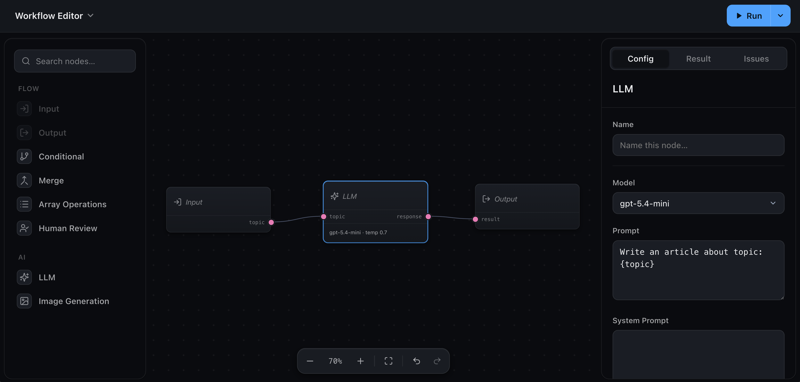

<div align="center">


# Wayflow

**The visual workflow editor you embed, not rebuild.**

[](https://www.npmjs.com/package/wayflow)&nbsp;
[](LICENSE)&nbsp;
[](https://www.npmjs.com/package/wayflow)

</div>

<br />



<br />

Wayflow drops a complete workflow editor into your product. From a single call you
get the canvas, the node palette, the config panel, and the run controls — and
Wayflow _runs_ the workflows your users build, in the browser or on your server.
Powered by AI when you want it, plain logic when you don't.

It's plain TypeScript and the DOM, with no UI framework — so it works the same in
React, Vue, Svelte, or no framework at all.

## Install

```sh
npm install wayflow
```

## Quick start

Point `createWorkflowEditor` at a container, and that one call mounts the whole
editor:

```ts
import { createWorkflowEditor } from 'wayflow'

const editor = createWorkflowEditor(document.getElementById('editor'))
```

That's the editor on screen. To execute a graph, hand it a runtime — the
[Quickstart](https://wayflow.build/docs/getting-started/quickstart) walks you from
install to a running workflow in a few minutes.

## Why Wayflow

- **The whole editor, one call** — canvas, node palette, config panel, and run
  controls. A complete workspace, not a blank canvas you finish yourself.
- **It runs your workflows** — a real execution engine ships in the box.
  Prototype in the browser with no backend, then run the same graph on your server.
- **AI when you want it, logic when you don't** — built-in LLM, tool-calling,
  branching, and map-over-list nodes mix freely with your own deterministic steps.
- **Pause for a human, resume later** — suspend a run for an approval or a
  decision, then pick it right back up. Human-in-the-loop is built in.
- **Bring your own models** — provider-neutral LLM and image adapters. Your keys,
  your vendor — never locked to one.
- **Brand it from one token** — set the accent and every surface, hover, and
  focus ring recomputes. Light and dark stay in sync.

Ships with full TypeScript types, zero runtime dependencies, and a tree-shakeable
package.

## Works with any framework

Wayflow is plain TypeScript and the DOM, so it mounts inside **React**, **Vue**,
**Svelte** — or no framework at all — with a single call. No wrappers, no adapters.

## Documentation

Full docs live at **[wayflow.build](https://wayflow.build)**.

- [Quickstart](https://wayflow.build/docs/getting-started/quickstart) — a running editor in a few minutes
- [Building workflows](https://wayflow.build/docs/building-workflows/node-library) — the built-in nodes and custom node types
- [Running workflows](https://wayflow.build/docs/running-workflows/overview) — the runtime, in the browser or on a server
- [Reference](https://wayflow.build/docs/reference/overview) — the full API

## Examples

The [`examples/`](examples/) folder has focused, runnable apps — a quickstart,
custom nodes, a low-level setup, preview mode, and an editor wired to a backend.

## Develop in a container

The repo ships a [Dev Container](https://containers.dev/): open it and you get
the whole toolchain, dependencies already installed, and every example one
command away. Nothing to install locally except Docker and VS Code — or not even
that, in GitHub Codespaces.

[](https://codespaces.new/TahaSh/wayflow)&nbsp;
[](https://vscode.dev/redirect?url=vscode://ms-vscode-remote.remote-containers/cloneInVolume?url=https://github.com/TahaSh/wayflow)

Every new terminal greets you with what's installed and the commands you'll use:

```text
__        __           __ _
\ \      / /_ _ _   _ / _| | _____      __
 \ \ /\ / / _` | | | | |_| |/ _ \ \ /\ / /
  \ V  V / (_| | |_| |  _| | (_) \ V  V /
   \_/\_/ \__,_|\__, |_| |_|\___/ \_/\_/
                |___/

 * Node v22 · pnpm 10.17.1: installed
 * Build:  pnpm build
 * Test:  pnpm test (watch: pnpm test:watch)
 * Format + lint:  pnpm check (autofix: pnpm check:write)
 * Run an example:  pnpm -C examples/quickstart dev → http://localhost:5173
 * Ollama (for with-backend): reachable
```

### What's included

| Tool | What it's for | Try it |
| --- | --- | --- |
| **Node 22** | The same version CI runs | `node --version` |
| **pnpm** | Pinned by `packageManager` in `package.json`, via corepack | `pnpm --version` |
| **tsdown**, **Vitest**, **Biome** | Build, test, and format + lint — the repo's own dev dependencies | `pnpm build && pnpm test && pnpm check` |
| **GitHub CLI** (`gh`) | Repos, PRs, and issues from the terminal | `gh auth login` |
| **git**, **zsh**, **figlet** | Version control, a friendly shell, and the welcome banner | open a new terminal |

VS Code installs the **Biome** (set as the formatter, with format on save),
**Vitest**, and **Claude Code** extensions.

### Run an example

The quickstart starts by itself when the container attaches and opens in your
browser. To run a different example, stop it (`Ctrl+C` in its terminal) and
start another; each is a Vite app on the forwarded port `5173`.

| Example | Run | Opens |
| --- | --- | --- |
| [quickstart](examples/quickstart) | `pnpm -C examples/quickstart dev` | `:5173` |
| [custom-nodes](examples/custom-nodes) | `pnpm -C examples/custom-nodes dev` | `:5173` |
| [low-level](examples/low-level) | `pnpm -C examples/low-level dev` | `:5173` |
| [preview-mode](examples/preview-mode) | `pnpm -C examples/preview-mode dev` | `:5173` |
| [with-backend](examples/with-backend) | `pnpm -C examples/with-backend dev` | `:5173`, API on `:3001` |

Edits to the library source hot-reload into a running example.

### Using Ollama with `with-backend`

`with-backend` talks to an OpenAI-compatible model server. In the container it
reaches the [Ollama](https://ollama.com) on **your machine** through
`OLLAMA_BASE_URL` (`http://host.docker.internal:11434/v1`), so models you've
pulled on the host just work — the banner shows whether Ollama is reachable. In
Codespaces there's no host Ollama; point `server/runtime.ts` at a hosted
provider instead (see the example's README).

### Good to know

- **Clone in Volume is fastest.** The Dev Containers badge clones into a Docker
  volume, which is much quicker than a bind-mounted folder on macOS and Windows.
- **Reopening a local checkout is safe.** `node_modules` and
  `examples/node_modules` live in container volumes, so the container's Linux
  binaries never replace your host's.
- **Changed dependencies?** Run `pnpm install && pnpm -C examples install`, or
  rebuild the container for a clean slate.

## Contributing

Contributions are welcome — see [CONTRIBUTING.md](CONTRIBUTING.md).

## License

[MIT](LICENSE) © Taha Shashtari
